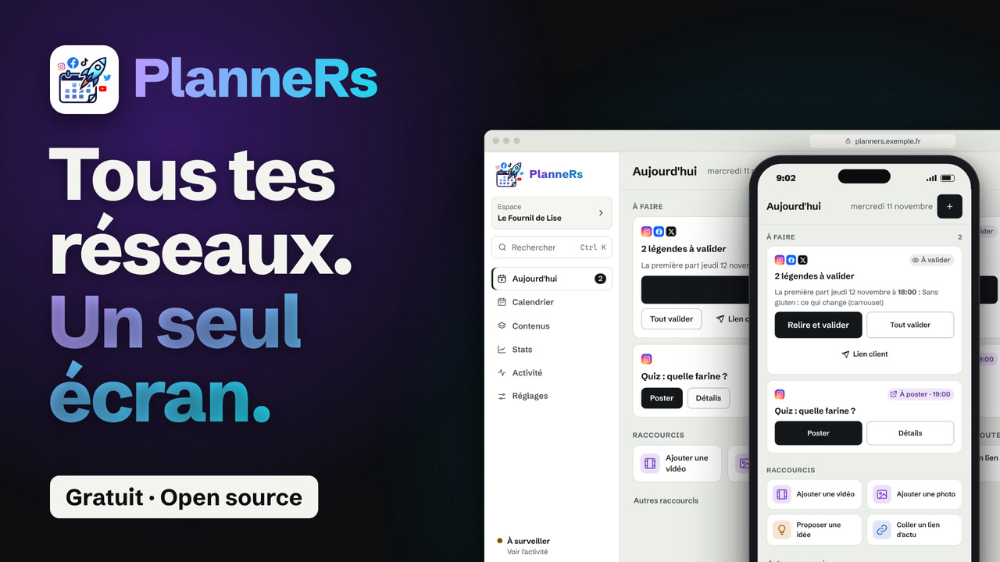

# PlanneRs

Planifier, valider et suivre ses publications sur les réseaux sociaux, depuis un seul écran.
Auto-hébergé sur Cloudflare (gratuit pour un usage personnel), sans abonnement ni service tiers.

*Plan, approve and track your social media posts from one screen. Self-hosted on Cloudflare. The interface is available in French and English (Settings › Workspace › Language); the documentation is in French for now.*

| [](https://youtu.be/mzCHU1rWABg) | [](https://youtu.be/9xj9O0S913I) |
|---|---|
| ▶ [Un seul écran](https://youtu.be/mzCHU1rWABg) (35 s) | ▶ [Une journée avec PlanneRs](https://youtu.be/9xj9O0S913I) (48 s) |

*Two short intro videos (in French).*

**Essayer sans rien installer :** [la démo en ligne](https://naod6473.github.io/PlanneRS-MIT/) (données d'exemple, rien n'est publié).

## Installer en une commande

```bash
npx github:Naod6473/PlanneRS-MIT
```

La même commande sur Windows, macOS et Linux (il faut [Node.js](https://nodejs.org) 20 ou plus). Elle crée la base, met le site en ligne sur ton compte Cloudflare, génère la clé de chiffrement et t'affiche l'adresse. Compter 5 à 10 minutes.

Pas de terminal ? Un bouton fait la même chose depuis le navigateur :

[](https://deploy.workers.cloudflare.com/?url=https://github.com/Naod6473/PlanneRS-MIT)

Le guide complet : [docs/demarrage/installation.md](docs/demarrage/installation.md). Tu peux aussi te faire [guider par une IA](docs/demarrage/installation-avec-une-ia.md).

### Pourquoi c'est simple

| | PlanneRs | Un outil classique à héberger soi-même |
|---|---|---|
| Ce qu'il faut | Un compte Cloudflare gratuit | Un serveur (VPS) à louer |
| Ce qui tourne | Un Worker et une base D1, gérés par Cloudflare | Plusieurs conteneurs : application, base de données, cache, file de tâches |
| Installation | Une commande ou un bouton | Docker, variables d'environnement, nom de domaine, certificat |
| Mises à jour | Un déploiement de quelques secondes | Nouvelles images, migrations, redémarrages |
| Sauvegardes | Chaque semaine, automatiques | À mettre en place |
| Coût | 0 € pour un usage personnel | Le serveur, chaque mois |

Ce que PlanneRs ne fait pas, volontairement : génération d'images ou de vidéos par IA, gestion d'agence multi-clients. Il fait une chose, bien : planifier, valider, publier, suivre.

## Ce que ça fait

- **Aujourd'hui** : la prochaine étape en une phrase, ce qui t'attend d'abord (échecs, posts manqués, posts à faire à la main, légendes à valider), puis le programme du jour.
- **Calendrier** : une grille par créneaux (tes horaires types en lignes, les jours en colonnes). Glisser-déposer à la souris et au doigt (appui long), avec confirmation désactivable. Vues Vignettes (7 colonnes avec images), Mois et Grille du profil Instagram, et les chiffres de la semaine en cartes cliquables.
- **Contenus** : tableau de production (idée → publié), liste sujet × réseaux, aperçu Instagram de chaque post.
- **La Fabrique** : où en est chaque vidéo (script, voix, montage, sous-titres, relu), qui y travaille (toi ou une IA), son storyboard et la vidéo finie à regarder avant de valider ([guide](docs/utilisation/la-fabrique.md)).
- **Stats** : abonnés, vues, portée et classement des publications.
- **Activité** : état des comptes et du robot, journal en clair.
- **Réglages** : comptes, stockage des médias, créneaux, modèles, règles d'envoi, notifications, équipe.
- **Automatisations** : un flux RSS repris en posts à relire, un commentaire ajouté quand un post dépasse un nombre de likes, une [API](docs/reference/api.md) pour n8n, Make ou Zapier ([guide](docs/utilisation/automatisations.md)).
- **Assistants IA** : un serveur MCP intégré (`/mcp`) pour Claude, Codex ou ChatGPT : lire le planning, préparer, modifier et valider des posts ([guide](docs/reference/assistants-ia.md)).

Principes :

- **Rien ne part sans validation.** Une légende non validée est affichée « À valider » et le robot ne l'envoie pas.
- **Un échec s'explique** en trois lignes : ce qui s'est passé, pourquoi, ce que tu peux faire.
- **Pas de doublon** : si le réseau principal a publié et qu'un relais échoue, on ne relance pas.
- **Le statut se lit** avec un mot et une icône, pas seulement une couleur.

## Réseaux pris en charge

| Réseau | Publication automatique | Sinon |
|---|---|---|
| Instagram (Reels, carrousels, images, stories) | Oui, API Graph | |
| Page Facebook | Oui, API Pages | |
| Threads, LinkedIn, X, Bluesky, Mastodon, Pinterest, YouTube (Shorts) | Oui | |
| TikTok (vidéos) | Oui, en brouillon ou en direct | Photos : rappel « à poster à la main » avec copie du texte |

Stockage des médias : Google Drive, OneDrive, Dropbox, WebDAV (source) ; Cloudflare R2 / S3, GitHub Pages (hébergement public).
Notifications : ntfy, Telegram, webhook signé (pour brancher un autre outil ou un assistant IA).

## Documentation

Tout est dans [docs/](docs/README.md), classé par catégorie : installation, utilisation, configuration de chaque réseau (avec les liens vers les consoles et la documentation officielle), stockage, notifications, dépannage, sécurité. Chaque page a un en-tête (titre, description, catégorie, mots-clés) ; `npm run docs:index` vérifie les liens et régénère [docs/index.json](docs/index.json) pour la recherche.

## Essayer sans rien installer

```bash
npm run demo        # puis ouvre http://localhost:8787/?demo
```

Ou `npm run build:demo` pour obtenir `dist/demo.html`, un seul fichier à ouvrir dans le navigateur. Les données de démo sont fictives et restent dans ton navigateur.

## Organisation du code

```
web/              interface (HTML, CSS, JavaScript sans étape de compilation)
  js/core.js      règles partagées avec le serveur (statuts, contrôles, créneaux)
worker/src/       serveur Cloudflare Worker
  index.js        API /api/* et déclencheur planifié
  robot.js        robot de publication (testé dans test/robot.test.mjs)
  adapters/       un module par réseau, plus les notifications
  storage/        stockages sources et hébergements publics
migrations/       schéma de la base D1
docs/             documentation en Markdown (voir docs/README.md)
```

Ajouter un réseau = écrire `worker/src/adapters/<réseau>.js` avec `fields`, `publish()` et `test()`. Voir [docs/reference/architecture.md](docs/reference/architecture.md#écrire-un-connecteur).

## Tests

```bash
npm test            # tests unitaires
npm run test:e2e    # parcours dans la démo, avec Playwright (npx playwright install chromium)
```

## Licence

MIT. Les logos des réseaux viennent de [Simple Icons](https://simpleicons.org) (CC0) ; les marques appartiennent à leurs détenteurs et servent seulement à identifier les services.
