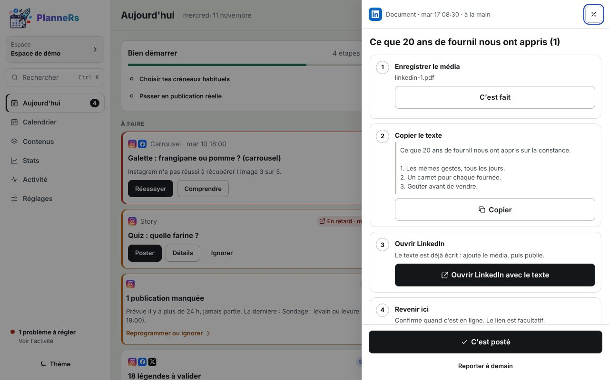
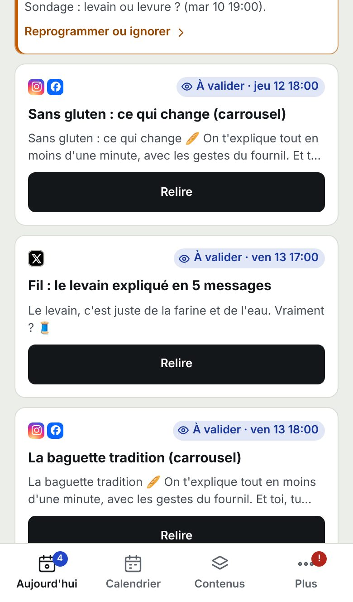

# Poster à la main

Pour les réseaux sans connexion automatique (ou à l'API payante), PlanneRs prépare tout et te le rappelle à l'heure. Coche-les une fois pour toutes dans Réglages › Règles et contrôles › **À poster à la main**. Une petite flèche violette marque ces posts partout.

## 1. Sur ordinateur

À l'heure prévue, le post apparaît dans **À faire**. **Poster** ouvre l'aide :

1. **Enregistrer le média**.
2. **Copier le texte** (la version propre à ce réseau, s'il y en a une).
3. **Ouvrir LinkedIn avec le texte** : pour X, LinkedIn, Threads et Bluesky, le réseau s'ouvre avec le texte déjà écrit. Il reste à ajouter le média et publier.
4. **C'est posté** : le réseau est noté comme fait, et l'aide passe au suivant.

## 2. Sur téléphone

L'écran **À faire maintenant** montre une carte par post :

- **Glisse à droite** : valide le texte, ou ouvre l'aide « Poster à la main ».
- **Glisse à gauche** : reporte au lendemain, même heure.
- Dans l'aide, **Poster en un geste** copie le texte et envoie la vidéo dans l'app choisie par le menu Partager.

« Annuler », dans le message du bas, défait chaque geste. Détails : [Aujourd'hui › Poster à la main](../utilisation/aujourdhui.md#poster-à-la-main).
