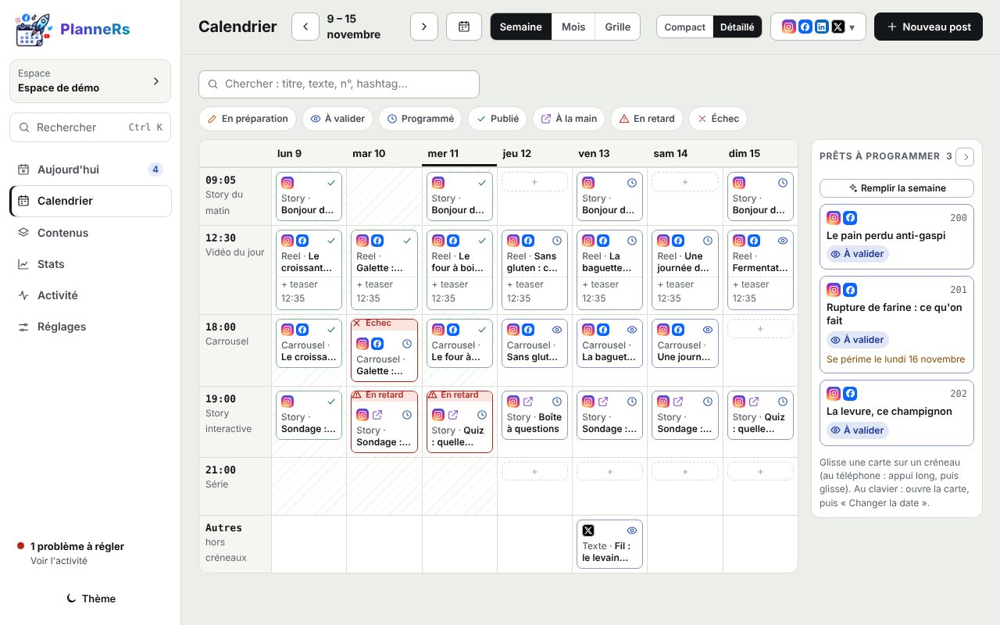
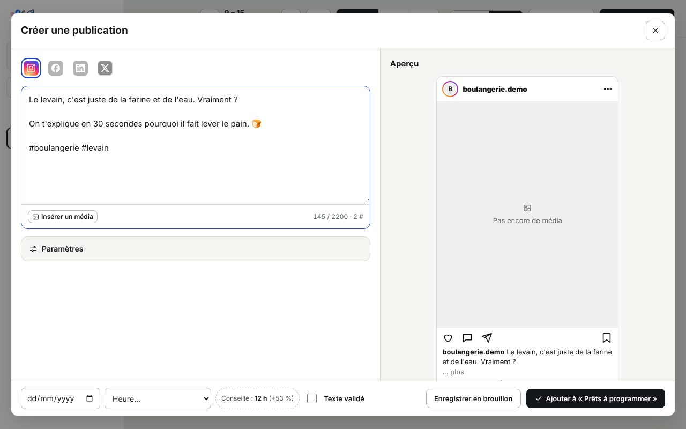
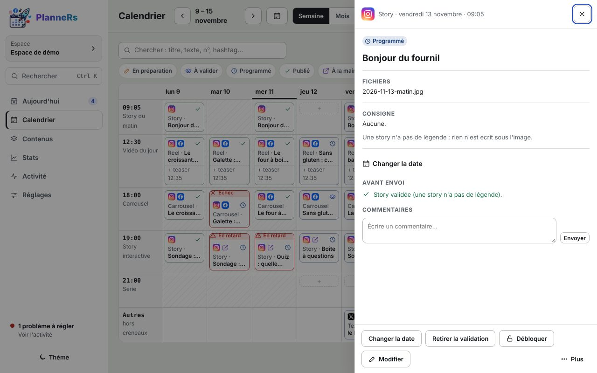

# Programmer un post

En 3 étapes, du calendrier vide au post qui partira tout seul.

## 1. Partir du calendrier

Le calendrier montre la semaine : tes créneaux en lignes, les jours en colonnes. Chaque carte porte une pastille d'étape (Idée, En préparation, À valider, Programmé, Publié) ; un échec ou un retard ajoute un bandeau rouge.

Clique sur **Nouveau post** (ou touche **N**), ou sur le **+** d'une case vide pour pré-remplir le jour et l'heure.

## 2. Écrire dans la fenêtre de création

C'est le seul endroit où l'on modifie un post.

1. **En haut, les réseaux** : clique sur un logo pour l'ajouter. Le premier coché est le réseau principal.
2. **Le texte** : le compteur indique la limite du réseau le plus court et le nombre de hashtags.
3. **Insérer un média** : depuis l'appareil, en glissant un fichier, depuis un lien ou depuis la **Bibliothèque**.
4. **Paramètres** : titre, série, format, publication à la main, premier commentaire, texte alternatif.
5. **En bas** : choisis le jour et le créneau (**Conseillé** propose l'heure où tes posts marchent le mieux), coche **Texte validé**, puis **Programmer**.

Sans date, le post va dans **Prêts à programmer**, à droite du calendrier : glisse-le plus tard sur un créneau, ou utilise **Remplir la semaine**.

## 3. Vérifier dans la fiche

Un clic sur la carte ouvre sa fiche : on y voit tout et on agit (valider, changer la date, poster, réessayer). Pour changer le texte ou les réseaux, **Modifier** rouvre la fenêtre de création.

Le post passe en **Programmé** : il partira tout seul à l'heure prévue. Pour aller plus loin : [Contenus](../utilisation/contenus.md), [Calendrier](../utilisation/calendrier.md).
