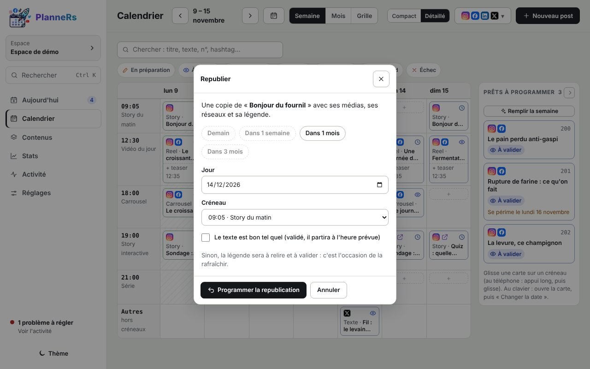
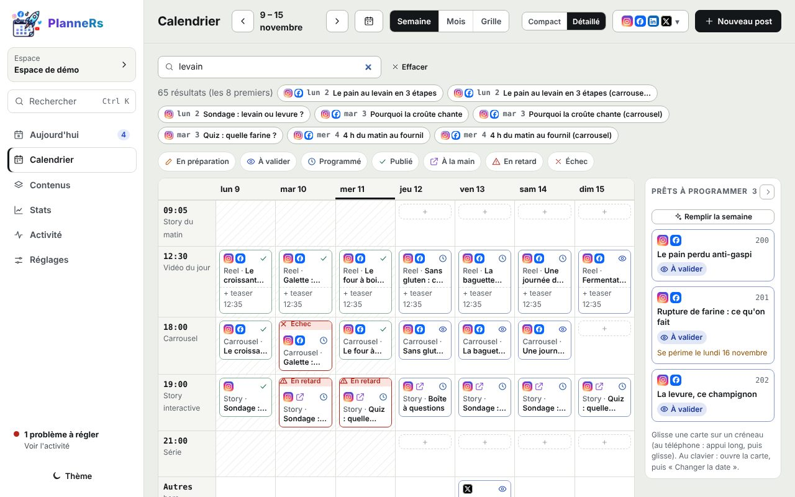
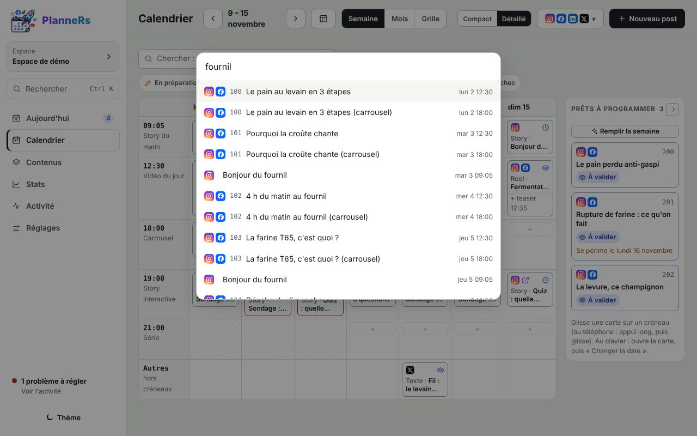
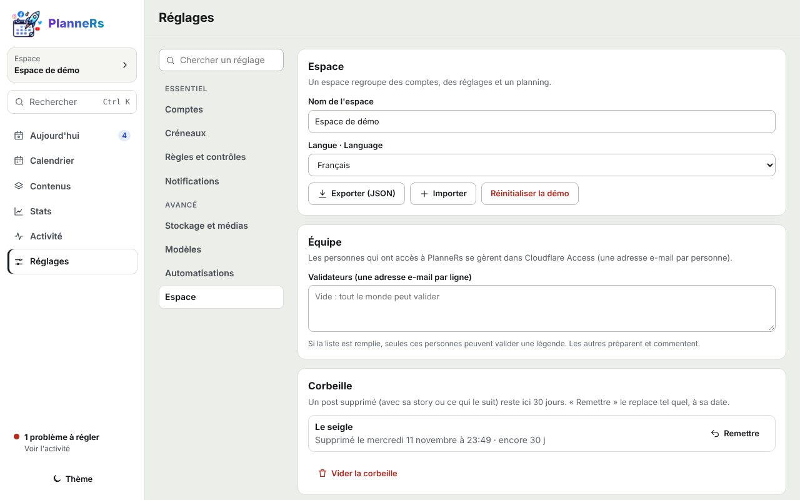

# Republier, retrouver, récupérer

## Republier un post qui a marché

Ouvre un post publié, puis **Republier** : une copie avec les mêmes médias, réseaux et texte.

Choisis **Demain**, **Dans 1 semaine**, **Dans 1 mois** ou **Dans 3 mois** (ou un jour et un créneau précis). Coche **Le texte est bon tel quel** pour qu'il parte sans relecture ; sinon, il attend ton OK dans **À valider**. Les Stats proposent aussi une carte **À republier** avec tes meilleurs posts de plus de 45 jours.

## Retrouver un post

La case **Chercher**, au-dessus du calendrier et des contenus, filtre sur le titre, le texte, le numéro, les hashtags et la note. Les premiers résultats de toutes les dates s'affichent : un clic ouvre le post. La liste **Séries** ne garde qu'une série.

La touche **/** place le curseur dans cette case. De n'importe où, **Ctrl K** (ou **⌘ K**) ouvre la recherche rapide : posts, actions et écrans. Les flèches choisissent, Entrée ouvre.

## Remettre un post supprimé

Un post supprimé va dans la **corbeille** pendant 30 jours. Juste après, « Annuler » dans le message du bas le remet. Plus tard : Réglages › Espace › **Corbeille**, puis **Remettre**. Il revient tel quel, à sa date.

