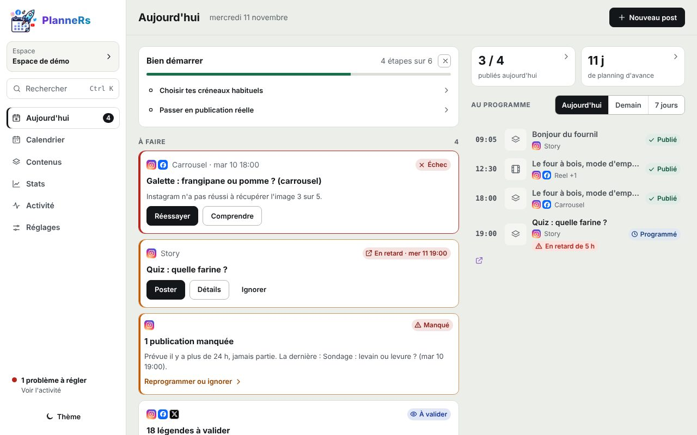
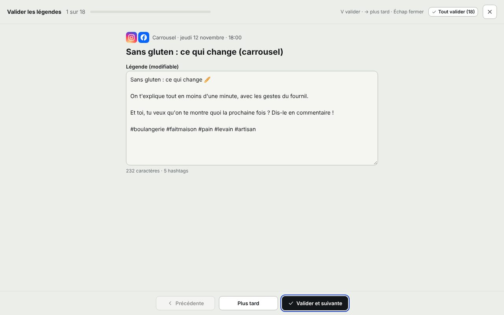

# Valider la semaine

Rien ne part sans ton OK. Une fois par semaine, 5 minutes suffisent pour tout relire.

## 1. Repérer ce qui attend

Sur **Aujourd'hui**, la carte **Légendes à valider** compte les posts des 14 prochains jours qui attendent ton OK. Ils ont la pastille bleue **À valider** partout dans l'app.

## 2. Relire un par un

**Relire et valider** les présente un par un. Le texte est modifiable sur place.

- **Valider et suivante** (touche **V**) : le post passe en **Programmé**.
- **Plus tard** (touche **→**) : passe au suivant sans valider.
- **Tout valider** : valide d'un coup ce qui passe les contrôles (média présent, hashtags dans la limite…), après une confirmation. « Annuler » dans le message du bas défait l'opération.

Sur téléphone, glisse simplement une carte **à droite** pour la valider (voir [Poster à la main](poster-a-la-main.md#2-sur-téléphone)).
