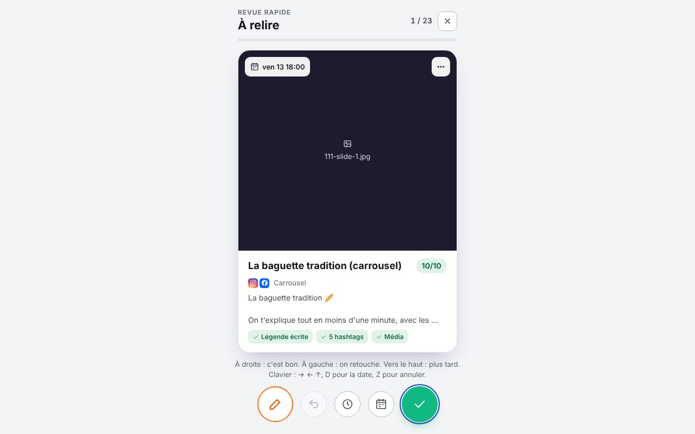

# Revue en pile

La revue en pile montre ce qui attend ton OK, **une carte à la fois**. Elle s'ouvre avec **Revue en pile** dans La Fabrique, ou avec **Relire et valider** sur Aujourd'hui et dans la liste « À valider ».

Dans la pile, tu trouves :

- les posts dont la légende n'est pas validée ;
- les vidéos de La Fabrique qui ne sont pas encore relues.

Les cartes sont rangées par date de publication.

## Sur la carte

- **La vidéo.** Touche le bouton Lecture pour la regarder.
- **La date de publication.** Touche-la pour la changer.
- **Le bouton ….** Il ouvre les autres actions.
- **La note de contrôle sur 10** et les points vérifiés : légende écrite, hashtags, média, durée, limites des réseaux.
- **Les points bloquants**, en rouge. Un média manquant ou une légende vide, par exemple. Tant qu'il en reste un, la carte ne peut pas être validée.

## Les gestes

| Geste | Bouton | Clavier | Effet |
| --- | --- | --- | --- |
| Glisser **à droite** | ✓ | → | **C'est bon !** La légende est validée, la vidéo est marquée relue, et le post part à l'heure prévue. Des confettis saluent le geste. |
| Glisser **à gauche** | crayon | ← | **On retouche.** Tu coches les raisons (accroche, durée, sous-titres, son…) et tu écris un mot pour l'équipe. |
| Glisser **vers le haut** | horloge | ↑ | **Plus tard.** La carte passe en fin de pile. |
| | calendrier | D | **Changer la date.** Choisis le jour et le créneau en deux touches, ou « Sans date ». |
| | flèche retour | Z | **Annuler** le dernier geste, même après plusieurs cartes. |

Sur téléphone, valider fait aussi vibrer l'appareil. Après trois validations de suite, un compteur « 🔥 d'affilée » s'affiche. La fin de la pile fait le récapitulatif : nombre de cartes validées, nombre en retouche, et temps passé.

## Ce que devient une retouche

Ton mot est ajouté aux **commentaires** de la vidéo. Dans **La Fabrique**, l'étape « Relu » repasse à faire avec ce mot, et la carte affiche **À retoucher**.

L'équipe le voit, et Claude aussi par le lien MCP. La vidéo revient dans la pile dès que quelqu'un a de nouveau travaillé sur une étape : script, voix, montage ou sous-titres.

## Plus d'options (bouton …)

- **Changer la date**.
- **Modifier la légende**, sans quitter la pile. La légende modifiée reste à valider.
- **Revoir plus tard**.
- **Ouvrir la fiche du post**, ou la vidéo **dans La Fabrique**.
- **Ne pas publier** : le contenu retourne dans les idées, sans date.

Seuls les validateurs désignés peuvent valider (Réglages › Espace). Les autres membres peuvent quand même renvoyer une carte en retouche.
